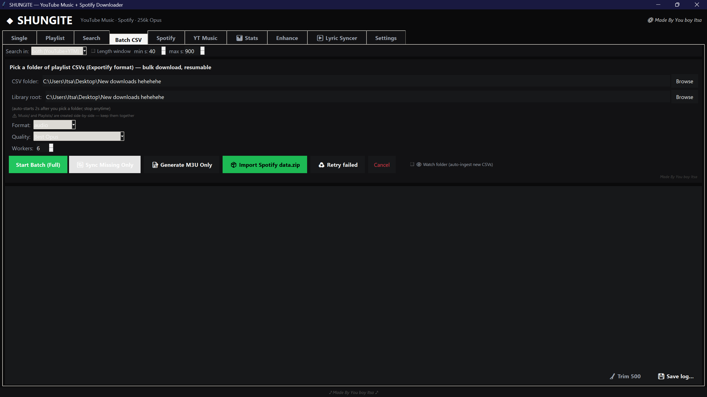
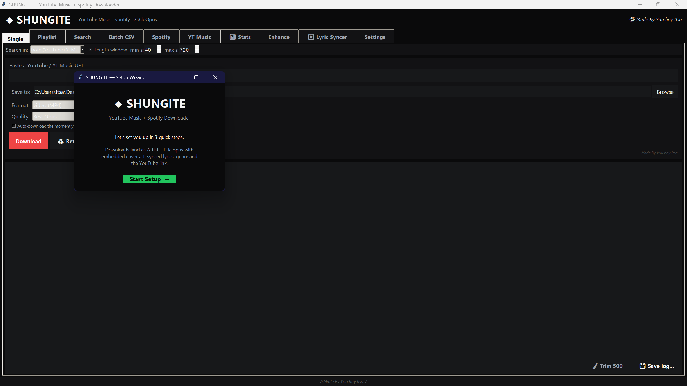
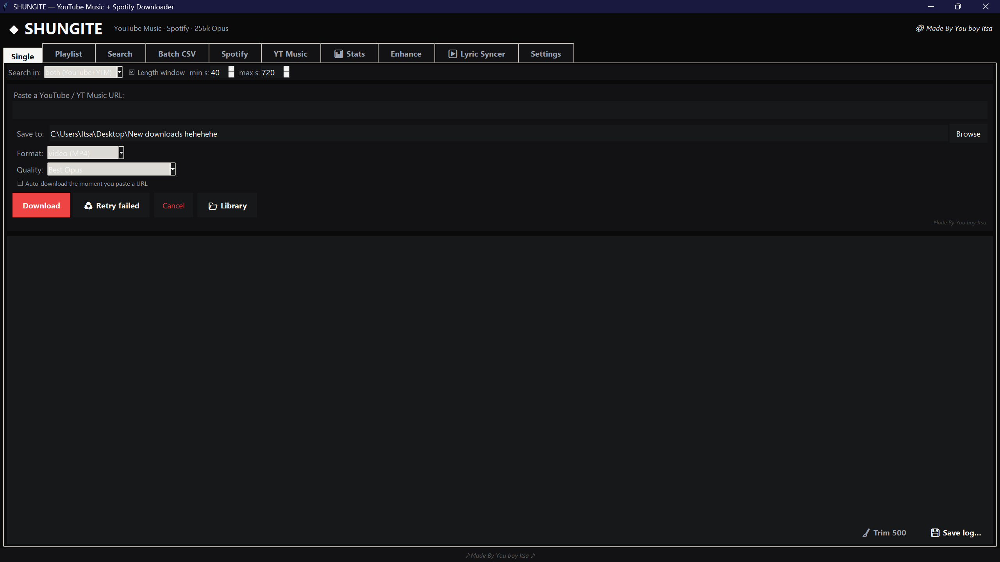
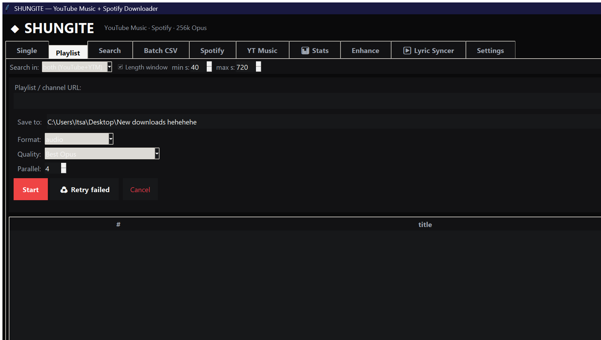
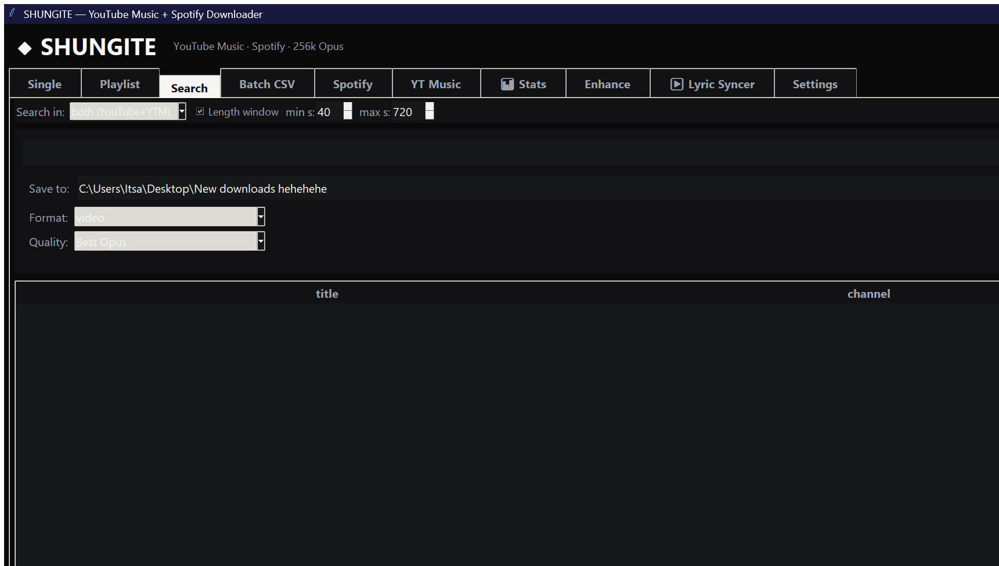
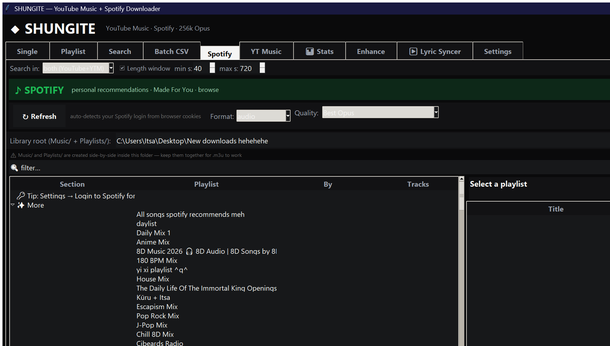
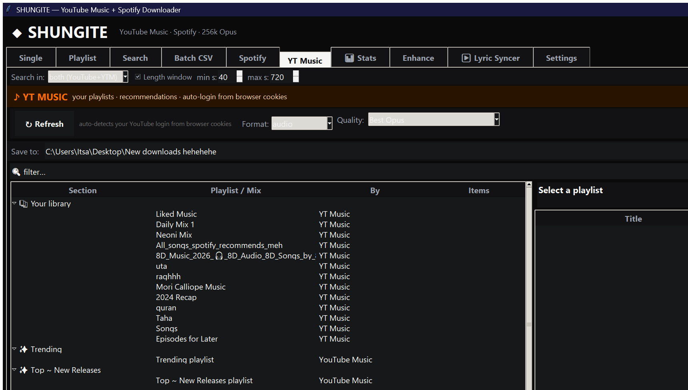
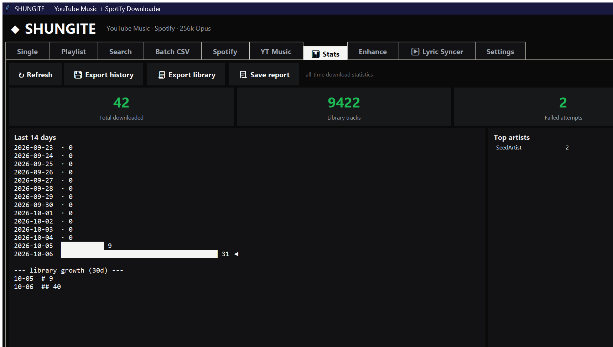
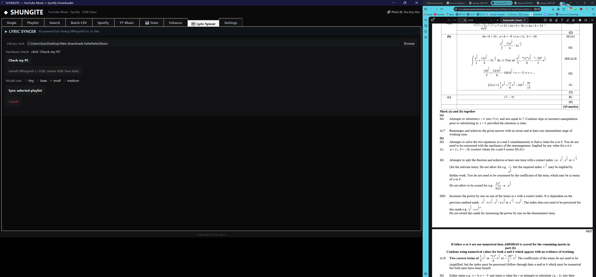
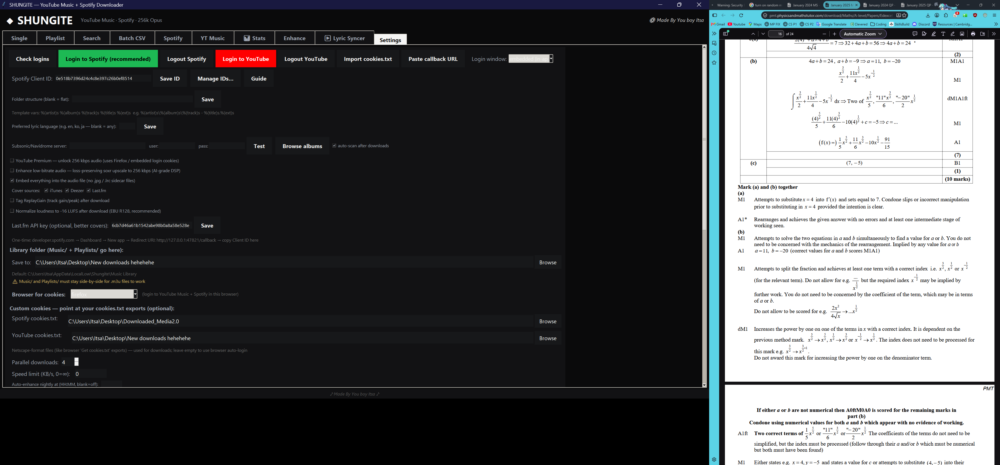

<div align="center">

# SHUNGITE

**A YouTube Music and Spotify downloader for Windows**

Give it a link, a playlist, a CSV folder, a Spotify login, or your full GDPR
history export. For every song it finds the official upload on YouTube,
downloads the best audio, and writes the metadata into the file itself:
cover art, synced lyrics in the original language, genre, and the exact
source URL.


**[Download the latest release](https://github.com/IrtezaAsif/Shungite/releases/latest)** — installer or portable zip, nothing else to install

**[Discord](https://discord.gg/whczzt5VS7)** — support, bug reports, feature requests

</div>

---



---

## Table of contents

1. [What it does](#what-it-does)
2. [Installation](#installation)
3. [How the pieces fit](#how-the-pieces-fit)
4. [Every tab](#every-tab)
5. [The matching engine](#the-matching-engine)
6. [The enrichment pipeline](#the-enrichment-pipeline)
7. [The download engine](#the-download-engine)
8. [Audio formats](#audio-formats)
9. [Where your data lives](#where-your-data-lives)
10. [Phone remote](#phone-remote)
11. [Command line](#command-line)
12. [Testing](#testing)
13. [Build from source](#build-from-source)
14. [Project layout](#project-layout)
15. [Discord community](#discord-community)
16. [Troubleshooting](#troubleshooting)
17. [Known limitations](#known-limitations)
18. [License](#license)

## What it does

Every song, however it arrived, goes through the same five steps:

1. **Search.** Three backends run in order: the InnerTube YouTube Music API,
   a cookie-authenticated ytsearch pass, and ytmusicsearch as the last
   resort. All three attach your harvested YouTube login.
2. **Pick.** The matcher scores every result and takes the most-viewed
   *correct* upload: the official release, never a cover, a slowed edit, a
   nightcore, a lyric-video reupload, or a live cut.
3. **Download.** Best audio, stream-copied into real Opus (or M4A). No
   lossy re-encode.
4. **Enrich.** Cover art, timed synced lyrics in the original language,
   genre, and the exact source URL are written into the file's own tags.
5. **Clean up.** Sidecar files, partials, and stray thumbnails are removed.
   Your Music folder ends up holding audio files and nothing else.

The design rule in the codebase is that there is one pipeline: one matching
function, one download function, one enrichment pass. A download from the
Playlist tab and a download from a 6,000-row CSV run through identical
code, so behavior you verify in one place holds everywhere.

## Installation

### The installer

Grab the `Shungite_Setup_*.exe` from
[Releases](https://github.com/IrtezaAsif/Shungite/releases/latest) and run
it. You get a setup wizard, a Start-menu entry, an optional desktop
shortcut, and a proper uninstaller (Add/Remove Programs). The uninstaller
leaves your music and settings alone.

### Portable

`Shungite_win64.zip` from the same page. Extract anywhere, run
`Shungite.exe`. No install, no admin rights, no registry writes.

### First run



The first launch walks you through three steps: a welcome page, choosing
your Music Library folder (a `Music/` and `Playlists/` pair is created
inside it), and an optional embedded YouTube login. That login is worth
doing: a logged-in session is what keeps YouTube's bot walls away from
bulk downloads, and the app reuses it for searches, playlist reads, and
transfers. It opens an embedded WebView2 window inside the app; your
default browser never pops open. The wizard never appears again.

All app data lives in `%USERPROFILE%\AppData\LocalLow\Shungite`: config,
cookies, login state, history, debug logs. Nothing in Program Files,
nothing in the registry. Legacy `.peak_*` files in your home folder from
older versions are migrated automatically on first touch.

## How the pieces fit

The components are not independent features. Each stage feeds the next:

```
              ┌─────────────────────────────────────────────────┐
              │                  SONG REQUEST                   │
              │  (URL · playlist · CSV row · Spotify login ·    │
              │   GDPR history · YT Music library · search)     │
              └───────────────────────┬─────────────────────────┘
                                      ▼
        ┌───────────────────────────────────────────────────┐
        │  innertube.py  → InnerTube search (YT Music API)  │
        │  search_youtube() → ytsearch + ytmusicsearch      │
        │  (cookie-authenticated via the harvested jar)     │
        └───────────────────────┬───────────────────────────┘
                                ▼
        ┌───────────────────────────────────────────────────┐
        │  matchers.py — strict_match()                     │
        │  hard junk gates → duration window → fusion       │
        │  scoring → official-channel bonuses → CJK bridge  │
        │  → "official audio" rescue re-search              │
        └───────────────────────┬───────────────────────────┘
                                ▼
        ┌───────────────────────────────────────────────────┐
        │  download_one() — yt-dlp engine                   │
        │  remote_components JS-challenge solver · TV-client│
        │  bot-check fallback · cookie policy · format      │
        │  demotion · paced retries · cancel support        │
        └───────────────────────┬───────────────────────────┘
                                ▼
        ┌───────────────────────────────────────────────────┐
        │  _post_download_fixups() — enrichment             │
        │  LRClib lyrics (duration- & language-keyed)       │
        │  → video's own captions (native-language pick,    │
        │  script-mismatch guard) → description fallback    │
        │  cover art (thumbnail → iTunes/last.fm/Deezer)    │
        │  genre (iTunes) · purl (source link) · clean tags │
        │  sidecar cleanup (glob.escape-safe)               │
        └───────────────────────┬───────────────────────────┘
                                ▼
              Song - Artist.opus    (+ .m3u per playlist,
                                    indexable, resumable)
```

A few of the connections that make this work end to end:

- The matcher needs the search, and the search needs the cookies. Every
  backend attaches the harvested YouTube login; without it, YouTube serves
  empty results on many networks. One login in Settings powers everything:
  searches, downloads, and transfers.
- Enrichment is keyed to the matched video, not the song. The `purl` tag
  records exactly which video the audio came from, which is also what
  makes lyrics and cover re-runs idempotent.
- Durations flow from Spotify into the matcher. When a CSV row or Spotify
  track carries its real length, the matcher's window tightens to ±25%
  around it, which kills live versions and radio edits on the first pass.
- Lyrics are language-aware from the title. Japanese, Korean, and Cyrillic
  titles select original-language lyrics, so your Ado songs get Japanese
  words, not machine-translated English.
- Every successful download is recorded in the library index. Sync Missing
  Only, the Spotify sync, and the Retry buttons all read the same index,
  so nothing is downloaded twice and an interrupted run resumes.
- A downloaded playlist produces the audio in `Music/` plus one `.m3u` in
  `Playlists/` built from that same index, so the m3u only ever references
  files that exist.

## Every tab

### Single



Paste a YouTube or YT Music URL, or a plain search query, and hit
Download. Auto-download on paste starts the moment you paste. A URL skips
matching entirely; a search query runs the full matcher. Enrichment runs
automatically when the download lands.

### Playlist



Paste a playlist URL. Every entry is resolved, then run through the same
match → download → embed chain, with per-track log lines and a Cancel that
kills in-flight ffmpeg process trees rather than just emptying a queue.
Already-have detection runs first, so re-running the same playlist only
fetches what's missing.

### Search



Type a query and get the scored results the matcher sees, then click one
to download it. There is also a search-my-library mode for finding what
you already have. Useful for eyeballing what the matcher would pick before
committing a large batch.

### Batch CSV


The bulk engine. Point it at a folder of CSVs; every `.csv` in the folder
is parsed as one playlist named after the file (UTF-8-BOM tolerant). Two
column layouts are understood: Exportify exports (CSV or Excel) and the
GDPR-format `Track Name / Artist Name(s) / Duration (ms)` layout. The
buttons:

- **Start Batch (Full):** parse everything, deduplicate against your
  library through the index, download everything missing with parallel
  workers (default 4, adjustable 1–15). Progress shows `[i/total]` with
  new, skipped, and failed counts, and the log prints a full line per
  track.
- **Sync Missing Only:** same engine, index check first, only gaps
  downloaded. Safe to run as often as you like.
- **Generate M3U Only:** build one `.m3u` per CSV from the current index
  without downloading anything. Handy for wiring playlists into a player
  before committing to the downloads.
- **Import Spotify data.zip:** the whole-history import. Request your
  account data from Spotify (Settings → Privacy → Download your data;
  Spotify emails it a few days later), then drop the zip here. Shungite
  reads every `Streaming_History_Audio_*.json` inside, meaning every track
  you have ever streamed since the account existed, deduplicates it to
  unique (track, artist) pairs, and writes `Spotify_history_all.csv`,
  ready for a batch run. Durations are left blank on purpose: the export's
  play-time field is how long you listened, not how long the song is, and
  feeding it to the matcher once produced hour-long "songs" that poisoned
  every match.
- **Retry failed:** re-runs only the tracks recorded in
  `failed_downloads.txt`, which logs the reason for each failure,
  including the search results the matcher saw at the time.

### Spotify



Log in through the embedded PKCE window (a community client ID is built
in). The tab then loads a tree of your account: your playlists (select
one, or SELECT ALL for all of them at once), your Made For You content
(Daily Mixes, daylist, Discovery and Release Radar), and liked songs and
albums. Playlists and mixes are read through the same partner endpoint
the Spotify web player itself uses, with your logged-in session cookie.
Failures are reported instead of swallowed: a playlist whose fetch fails
is skipped and said so, and an empty library view tells you which of
three states you're in (logged out, fetch failed with a reason, or
logged in with a genuinely empty account).

The actions:

- **Download Full Playlist:** for each selected playlist, fetch the
  tracklist, skip what the index says you have, match and download the
  rest, and write one `.m3u` per playlist.
- **Sync Missing + M3U:** the same thing with the index check first.
- **Merge mode:** with several playlists selected, their tracklists are
  merged and cross-deduplicated into one combined batch, so songs shared
  between playlists download once.
- **M3U Only:** playlists as files, no downloads.
- **→ YT Music (transfer):** a real playlist transfer, like TuneMyMusic
  but local and free. For each selected Spotify playlist, Shungite creates
  a real playlist on your music.youtube.com account through the InnerTube
  API, fetches the Spotify tracklist, finds the best duration-matched
  upload for every track (the same scoring used for downloads, not just
  the first hit), and adds it to the new playlist. No audio is
  downloaded; the result is a playlist sitting in your YT Music library,
  ready on any device where you use YT Music. This is the tested transfer
  direction.

### YT Music



The mirror of the Spotify tab for your YouTube Music account, using the
same embedded login. Browse and select your playlists, uploads, and liked
songs, and download them through the identical chain. The library view
has the same honest states as the Spotify one, including a distinction
between "couldn't reach YouTube Music" (a network problem) and "session
expired" (log in again).

The reverse transfer (YT Music → Spotify) also exists in the code, but it
has not held up in real use, so this README does not present it as a
working feature. See Known limitations.

### Stats



Reads the SQLite download history and the library index: counts and
sizes, top artists, success and failure tallies, and the failure report
that `failed_downloads.txt` accumulates, but queryable.

### Lyric Syncer



The third layer of the lyrics system, exposed as its own tool. Some songs
have no captions and no LRClib entry. For those, Shungite runs WhisperX
forced alignment on your NVIDIA GPU (CUDA is auto-detected): the known
lyric text is split into phrases, WhisperX aligns each phrase against the
actual audio in bounded sequential windows (monotonic by construction, so
lines can't scramble or bunch up), and a genuinely timed `.lrc` comes
out, embedded into the tags. The tab needs a whisperX venv on your
machine; see Troubleshooting.

### Settings



The YouTube login and Spotify login buttons, the cookie source (harvested
jar / browser extraction / manual cookies.txt, with a self-healing check
that clears a bad path before it can poison downloads), default quality,
per-tab search preferences and duration caps, Subsonic/Navidrome server
push, last.fm scrobbling key, the optional Phone remote, and pointers to
the diagnostics log.

## The matching engine

One function serves every tab: `_match_track()`, with scoring in
`matchers.py`. Its job is to find the most-viewed correct upload.

1. **Search, with fallback order.** InnerTube queries the YouTube Music
   search API (fast, real artist names, durations). If it comes back
   empty, a cookie-authenticated ytsearch runs; if that is bot-walled
   empty, ytmusicsearch is the last resort. All three attach the
   harvested login cookies.

2. **Hard gates.** A candidate whose title contains any junk word (unless
   your query contains it) can never be picked: slowed, sped up,
   nightcore, 8d, karaoke, reverb, mashup, fan made, amv, cover,
   unrequested remix, reaction, tribute, snippet, teaser, live, THE FIRST
   TAKE, full english, dolby, binaural, extended, lyrics/lirik/terjemahan
   (lyric-video channels), romaji, sub español, and friends. This is a
   disqualification, not a penalty, because a high-scoring cover would
   otherwise beat the official upload.

3. **Duration window.** The default sanity band is 40–720 seconds, which
   kills hour-long mixes. When the true track length is known (CSV or
   Spotify metadata), the band tightens to ±25% around it. Candidates
   with unknown duration are only trusted from official channels.

4. **Fusion scoring.** What survives is scored on fuzzy title/artist
   similarity, the search engine's own rank, and log-scaled view count,
   so the official 250M-view upload beats a 900-view reupload even when
   both rank first in text similarity. Official channels get graduated
   bonuses: YT Music's auto-generated Song/Topic channels most of all,
   then any channel whose name is the artist.

5. **Rescues.** If the best survivor is still unofficial or
   duration-less, the search is retried with "official audio" appended.
   Titles that poison searches (feat-lists, "(From 'X')", remix
   parentheticals) are simplified and retried. A CJK bridge scores
   Japanese/Korean/Chinese by character overlap, so 恋愛サーキュレーショ
   ン finds its official upload and a romanized query still lands on the
   Japanese original.

The net effect: you get the upload the artist published, which carries
the real cover, the real audio, and the real timed captions the next
section relies on.

## The enrichment pipeline

`_post_download_fixups()` runs for every download from every tab,
synchronously in the worker, so a file reported as done is finished.

| What | How |
|---|---|
| Cover art | The matched video's own thumbnail, re-encoded and embedded as a proper front-cover tag. Missing or placeholder artwork falls back to iTunes → last.fm → Deezer. |
| Synced lyrics | LRClib first, keyed by the file's real duration and preferred language, exact match first. If LRClib misses, the video's own timed captions are converted, with the original language preferred and a script check that rejects English lyrics for a Japanese/Korean/otherwise non-Latin song rather than serve a wrong-language transcription. Plain lyrics from the description are the last resort. |
| Genre | Per-track lookup against the iTunes Search API, cached per artist. |
| Source link | The exact YouTube URL in the `purl` tag, which is also what makes re-runs idempotent. |
| Tags | Title and artist always come from the song's metadata (Spotify or your CSV), never the video title. "Mystery of Love" is never filed as "mystery of love (slowed)". |
| Cleanup | `.vtt`, `.jpg`, `.webp`, `.info.json`, `.segments.json` sidecars are deleted after embedding, with glob-escaped patterns so bracketed names like `[English Ver]` can't dodge the cleanup. |

## The download engine

`download_one()` wraps yt-dlp with a recovery chain built from failure
modes seen in the wild:

- The JS-challenge solver (`remote_components: ["ejs:github"]`): YouTube
  requires solving a JavaScript challenge before serving player
  responses, and yt-dlp fetches its solver from GitHub on first use. This
  is the fresh-install fix. Without it, every download dies with "The
  page needs to be reloaded."
- Bot-check fallback: when a bot wall hits, the engine switches to the TV
  player client, which serves full audio formats without a PO token, and
  paces retries so bulk jobs stay under the radar. The embedded player
  client is never used for music, because it receives no audio formats.
- Cookie policy: searches and downloads always attach the harvested login
  cookies from app data, so a bulk run never depends on your live browser
  profile.
- Format demotion: premium format IDs your account doesn't have
  auto-demote to `bestaudio/best` instead of failing the track.
- Cancel that actually cancels: in-flight ffmpeg process trees are
  killed, not just the queue.
- No consoles anywhere: the exe is a GUI-subsystem binary and every child
  process (ffmpeg, deno, WhisperX) inherits CREATE_NO_WINDOW. The only
  window on your screen is the app itself.
- Self-diagnosis: every search, matcher decision, and download failure is
  logged with its real reason to
  `%USERPROFILE%\AppData\LocalLow\Shungite\search_debug.log`, and at
  startup the app runs a self-test download and writes `SELFTEST ok` to
  that log, including the state of its crypto and challenge-solver
  dependencies. A broken environment is visible in seconds, not hours.

## Audio formats

Two, on purpose:

- **Best Opus** (default): `bestaudio[acodec=opus]`, stream-copied into
  `.opus`. With Premium on your logged-in account, the hidden high
  formats are tried first and demote automatically if absent. No lossy
  re-encode, ever, unless a target bitrate is configured.
- **Best M4A**: `bestaudio[acodec=aac]`, copied into `.m4a`.

Video download stays available on the Single and Playlist tabs for the
odd music video.

## Where your data lives

| What | Where |
|---|---|
| Config, cookies, login state, debug log | `%USERPROFILE%\AppData\LocalLow\Shungite` |
| Downloads | `<Music Library>\Music`, as `Song - Artist.opus` |
| Playlists | `<Music Library>\Playlists`, one `.m3u` per playlist |
| Library index (resumability) | `Music\_index.txt` |
| Failure report | `<CSV folder>\failed_downloads.txt` |

Files are named `Song - Artist` from the song's own metadata (Spotify or
your CSV), not the video title. Files downloaded by older versions under
the old `Artist - Song` order keep their names and are still recognized
by the index; nothing gets renamed or re-downloaded behind your back.

## Phone remote

Off by default. When enabled (Settings → Phone remote), Shungite runs a
small web server so you can drive downloads from a phone:

- The server binds to 127.0.0.1 unless you explicitly turn on LAN
  exposure in Settings.
- Pairing shows a 6-digit PIN in the app, valid for 5 minutes. The phone
  gets its access token only by entering that PIN.
- Every API call requires the token as an `X-Remote-Token` header, and
  the API is JSON-only, which takes CSRF out of the picture.
- Tokens last 24 hours; a fresh pairing mints a fresh PIN.

## Command line

```
Shungite.exe --tab=batch
```

Opens directly on any tab: `single playlist search batch spotify ytm
stats enhance lyric settings`. Useful for shortcuts and automation. (The
Enhance tab is a leftover from an older design; enrichment now happens
automatically on every download.)

## Testing

The repo carries 121 tests in `tests/`. They are hermetic: no network (a
tripwire fails any test that reaches out), no real profile folders, no
real cookies. They cover the matcher against real-world wrong-pick cases,
the cookie crypto chain, the YT Music cookie-chain states, Spotify
library robustness (stale sessions, empty libraries, failure reporting),
the caption pipeline, the lyrics language guard, and download naming on
every path.

```
pip install pytest
python -m pytest tests/ -q
```

## Build from source

```
git clone https://github.com/IrtezaAsif/Shungite.git
cd Shungite
py -3.12 -m venv venv
venv\Scripts\pip install -r requirements.txt
venv\Scripts\python PEAK_GITHUB_true.py
```

Requirements: Python 3.12, WebView2 Runtime (preinstalled on Windows 11).
ffmpeg, ffprobe, and deno are bundled by the build spec. A CUDA GPU makes
the Lyric Syncer much faster.

The exe:

```
venv\Scripts\pip install pyinstaller
:: keep the environment clean: a stray PYTHONPATH pulls in the wrong
:: numpy and the exe crashes at startup
venv\Scripts\python -m PyInstaller PEAK_GITHUB_true.spec --noconfirm --clean ^
    --distpath dist3 --workpath build3\b
```

The spec bundles ffmpeg + ffprobe + deno, forces the GUI subsystem (no
console can ever appear), and embeds the version resource and the icon
into `dist3\Shungite\Shungite.exe`.

The installer: `installer\Shungite.iss` compiles with Inno Setup into the
setup wizard (license, destination, desktop shortcut, uninstaller).

CI: on every `v*` tag, a Windows runner installs dependencies, builds the
exe, compiles the installer, and attaches it to a GitHub Release. The
portable zip attached to each release is the locally verified build
uploaded byte-exact.

## Project layout

| File | What it is |
|---|---|
| `PEAK_GITHUB_true.py` | The entire app: every tab, `_match_track()`, `download_one()`, `_post_download_fixups()`, the playlist transfers, the Spotify history import, the batch engine, the wizard, the `--tab=` deep link, the startup self-test |
| `matchers.py` | `strict_match()`: hard junk gates, duration bands, popularity fusion, official-channel bonuses, CJK bridge |
| `titanium_enrich.py` | The enrichment module: covers, language-aware LRClib lyrics, VTT→LRC conversion, genre lookup, tag embedding, sidecar cleanup |
| `spotify_api.py` | Cookie/GQL Spotify client: playlists, Made-For-You sections, tracklists, library robustness |
| `spotify_oauth.py` | PKCE OAuth login and token refresh, playlist creation |
| `innertube.py` | YouTube InnerTube client: music search and authenticated playlist creation/addition for the Spotify→YTM transfer |
| `login_window.py` | Embedded WebView2 YouTube login window |
| `browser_cookies.py` | Cookie extraction from installed browsers + harvested-jar helpers |
| `download_queue.py` | Job queue with cancel events |
| `history_db.py` | SQLite download history (feeds Stats) |
| `musicbrainz.py` | MusicBrainz release/tracklist lookups |
| `sponsorblock.py` | SponsorBlock chapter marking via yt-dlp |
| `smart_playlists.py` | Auto-playlist generation |
| `acoustic_dedup.py` | Acoustic fingerprinting for duplicate detection |
| `subsonic_push.py` | Push a finished library to a Subsonic/Navidrome server |
| `web_remote.py` | The Phone remote: PIN pairing, token auth, JSON API |
| `shungite_bot.py` | The Discord bot (see Discord community) |
| `audit.py` | Offline functional audit of every tab's code path |
| `tests/` | The hermetic test suite |
| `docs/screenshots/` | The screenshots used in this README |
| `PEAK_GITHUB_true.spec` | PyInstaller spec |
| `installer/Shungite.iss` | Inno Setup installer script |
| `installer/shungite.ico` | App icon |
| `.github/workflows/build-installer.yml` | CI: exe + installer on tags |
| `version_info.txt` | Windows version resource |
| `requirements.txt` | Python dependencies (runtime + build split) |
| `RESTORE.md` | Backup restore notes |
| `build.bat` | One-shot Windows build helper |

## Discord community

The [server](https://discord.gg/whczzt5VS7) has support, bug-report,
feature-request, and showcase channels, plus a bot (prefix `sh!` or
`s!`): info commands (`sh!about`, `sh!download`, `sh!faq`), minigames
(hangman, trivia, typerace, slots, rps, 8ball), an economy with daily
rewards, XP with `sh!rank` and `sh!lb`, polls, welcome roles, and
anti-spam. Feature requests and bug reports posted there land in the
same places the developer reads.

## Troubleshooting

- "Requested format is not available": demotion handles this
  automatically. If you still see it, make sure the YouTube login is done.
- "The page needs to be reloaded" on a fresh install: fixed in all
  current builds via the challenge solver. Re-download the latest release
  if you have an old one.
- Downloads failing in bulk with bot-wall messages: the cookie jar is the
  suspect, not the engine. Redo the YouTube login inside the app
  (Settings), then retry.
- The Spotify or YT Music library looks empty: the tab says which of the
  three states you're in (logged out, fetch failed with a reason, logged
  in with a genuinely empty account). Follow what it says.
- Lyrics came out in the wrong language, or are missing: LRClib simply
  has no entry for some tracks, and the language guard deliberately
  refuses to serve a wrong-language transcription as a substitute. The
  Lyric Syncer is the tool for the stubborn ones.
- The Lyric Syncer wants a whisperX venv: `pip install whisperx
  "numpy<2"` with a CUDA-matched torch, or run from source.
- Spotify 403/429: the cookie/GQL client takes over automatically;
  downloads continue.
- Playlist transfer says "Log into YouTube Music first": do the YouTube
  login inside the app; the transfer writes to your YT Music account and
  needs those cookies.
- Anything else: open
  `%USERPROFILE%\AppData\LocalLow\Shungite\search_debug.log`. Every
  search, every matcher verdict, and every failure carries its real error
  there, and a `SELFTEST ok` line at startup confirms the whole chain
  works on your machine.

## Known limitations

Said plainly, so you know what you're getting:

- Lyric coverage has a floor. Obscure tracks have no LRClib entry and no
  captions. On an eclectic library, expect around three quarters of
  tracks to carry synced lyrics; the rest are instrumentals or genuinely
  unavailable, not bugs.
- The YT Music → Spotify transfer exists in the code but has not held up
  in real use. Spotify → YT Music is the direction that's tested. Check
  the result playlist before trusting the reverse one.
- A song whose title is fully romanized (Japanese song, Latin-alphabet
  title) gives the language guard nothing to check against, so in the
  rare case LRClib also misses, a wrong-language caption can still slip
  through.
- Playlist track counts can show blank in the Spotify library tree; the
  API shape doesn't carry a count there.
- Windows only. There is no macOS or Linux build.

## License

MIT. See [LICENSE](LICENSE). Downloaded content is for personal use;
respect YouTube's Terms of Service and copyright law.

<div align="center">

*Shungite — made by Irteza.*

</div>
